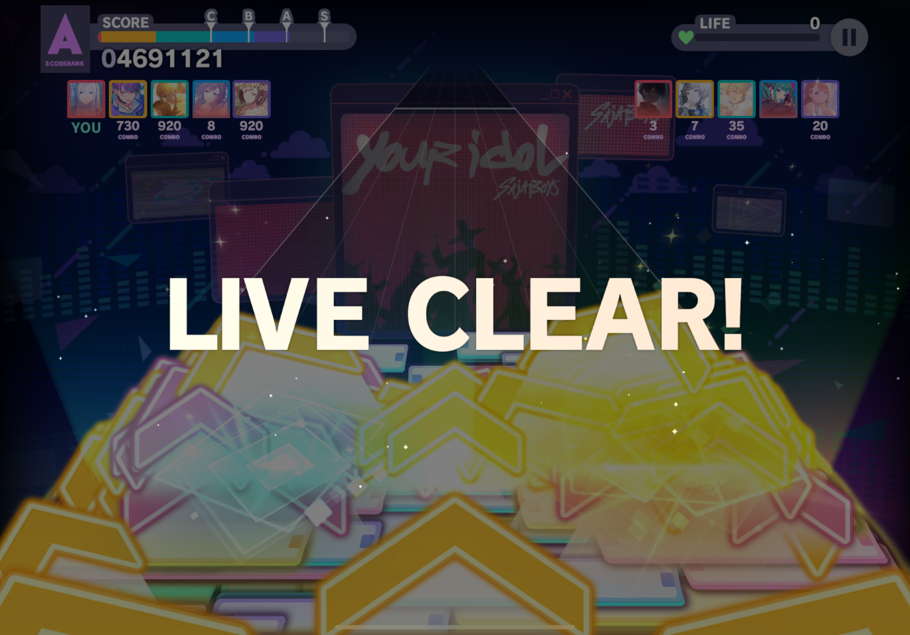

# Mods List
GS6 is a sandbox for us to play around with modding the game in fun and silly ways. There will be utility mods, fun/silly joke mods.

GS6 does not allow users to write their own mods. If you'd like a new mod (and it isn't insanely hard to make), create a Feature Request in issues, and if any assets are required, upload them there.

### Offline Sekai
Makes PJSK offline. Rewrites important assetbundle processes to skip decluttering and downloads, as well as network checks.

### Touch Indicators
Adds the Touch Indicators setting. Default off, change in Live settings (applies to entire game though).

### Auto Judgement
Adds the AUTO JUDGE setting. Default on (default game behaviour), change in Live settings. If off, turns off the AUTO judgement and instead makes auto play with PERFECT and have combo. (The Auto Live tag will still display.)

Do not use this mod to trick or mislead people into believing it is real gameplay.

### Custom Charts
Custom charts allow users to play custom charts in the game, offline.

For more information, please see [CUSTOM CHARTS](CUSTOM_CHARTS/README.md)

### Multilive
Adds ranked, multilive (both marathon and cheerful carnival) gamemodes into the game, fully offline with bots. Customizable options in settings.

- Unlock Ranked - forcefully unlock ranked even if requirements not met
- Bots Pick Songs - whether the bots should pick random songs
- Bots Always AP - whether the bots should always AP
- Bots Same Diff - whether the bots should always pick the same difficulty as you
- Instant Mode - whether to skip the lobby faked matchmaking delay
- Always My Song - whether to always choose your song (even if bots pick songs)
- No Miss Penalty - allows you to miss more than 50% of notes without disconnecting you at the end
- Bot Plocks - whether the random bot cards can be a plock
- Cheerful Carnival - whether to play in cheerful carnival or marathon mode
- CC Team - which team you'd like to be on in Cheerful Carnival mode
- Limited/Custom Songs in Ranked - how custom/limited songs should show up in Ranked
- Limited/Custom Songs in CC - how custom/limited songs should show up in Cheerful Carnival

### Tournament Mode
Adds tournament mode to all songs on all difficulties into the game. Play and save your best results with all skills disabled.

### Auto-Actions
Automatically applies actions if you lose AP or FC during a solo live. Turned off by default.

FC actions will be ignored if a higher AP action is set.

Actions available:
- Pause - automatically pauses the current solo live
- Retry - automatically retries the current solo live immediately
- Quit - automatically quits the current solo live immediately

### Playback Speed
Ability to modify playback speed in solo live.

## Rhythm Game Modifications
Adds new features to the rhythm game.
### NXSK Level Format
Adds support for the Next SEKAI Sonolus engine's LevelData format.

### Layers
Adds support for layers.

### Extended Lanes
Adds support for extended lanes.

### Damage Notes
Adds support for damage notes.

### More Colored Guides
Adds support for more guide colors.

### Decimal Lanes
Adds support for decimal lanes.

### Fake Notes
Adds support for fake notes.

## Official Bug Fixes
Fixes official game bugs.
### Cheerful Carnival CR詠ZY Bug
Fixes the CR詠ZY bug found in Cheerful Carnival. See screenshot below.

Occurs when a chart does not have FEVER.

### 9,999 Max Combo
Fixes combo rendering past 9,999 combo, where only 4 digits will ever render. Extended to 7 digits.

### Negative Hispeed Slide Heads
Fixes slide heads rendering on the judgement line in negative hispeed because the game assumes the slider is already past the judgement line while it's moving backwards.